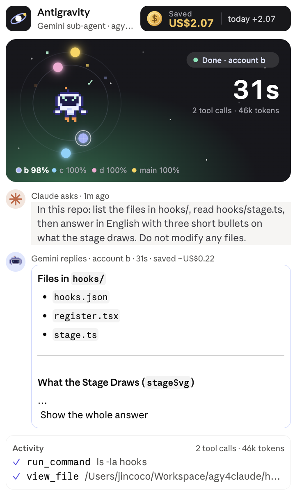
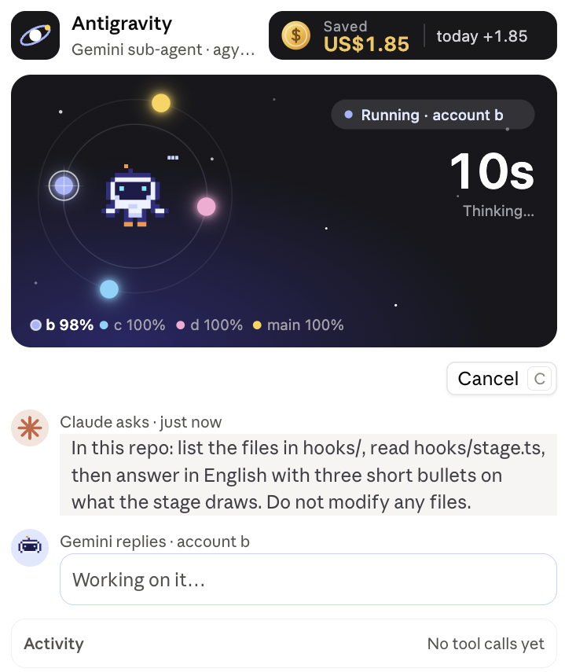
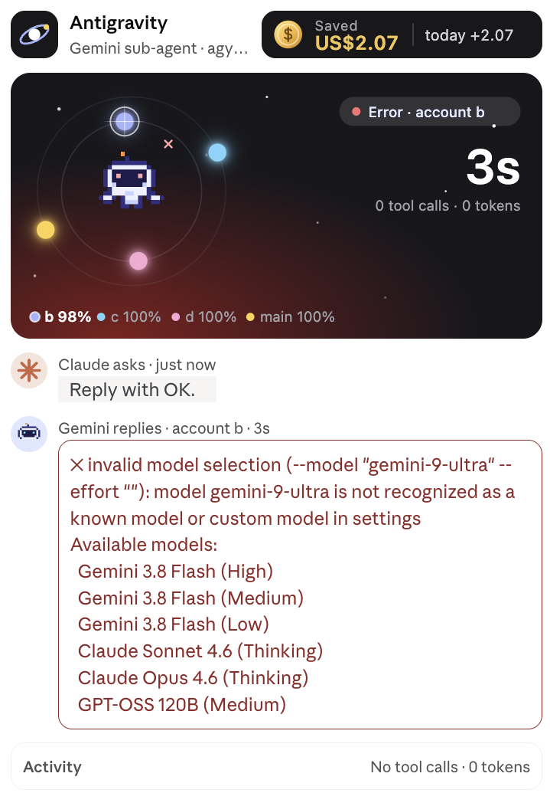

# agy4claude

A Claude Code mod that lets Claude hand work to **Antigravity CLI (`agy`)** — Google's Gemini agent —
as a sub-agent, rotate across several Google sign-ins to stretch the free quota, and watch every run in
a live side pane.

> Forked from [harvey0857/AGYforClaude](https://github.com/harvey0857/AGYforClaude). This fork adds
> sign-in rotation, a savings estimate and a mission-control pane with an animated stage.

<p align="center">
  
</p>

## What you get

| | |
| --- | --- |
| **Tool** `mcp__agy4claude__run` | Claude delegates a task to agy and gets its final answer back as the tool result. agy runs in the background (macOS / Linux): if the turn is interrupted, agy keeps going, and `result` (a job id, a conversation id or `"last"`) fetches its answer later, waiting if it is still running |
| **Command** `/agy` | `/agy` opens the pane · `/agy <prompt>` runs agy · `/agy result [job]` gets a background run's answer · `/agy usage` shows quota · `/agy accounts [add <name>]` lists or adds sign-ins · `/agy cancel` stops the run |
| **Pane** "Antigravity" | A starry stage with a pixel robot that acts out the run, one planet per sign-in, the conversation as a chat thread, the tool calls, history, and a running "Saved" total |
| **System prompt** | A short note telling Claude when and how to delegate, including web research |

## The pane

<p align="center">
  
  &nbsp;
  
</p>

- **Stage.** The robot shows what agy is doing: thinking, reading files, running commands, done
  (with confetti), failed, or out of quota (asleep). Each sign-in is a planet: its size and glow show the
  quota left, the one in use wears a ring and a star flare. The clock counts from the moment Claude
  handed the task over.
- **Thread.** Claude's request, then Gemini's reply (Markdown, long answers folded behind
  *Show the whole answer*). Follow-ups with `continue_conversation` stay in the same thread and on the
  same sign-in.
- **Saved.** Each run's tokens priced at Claude's rates (default Claude Opus 5.5, $4 / $20 per million
  input / output tokens), added up across sessions, with today's share. It is an estimate of what the
  same work would have cost on Claude.
- **Settings** fold into one line at the bottom: model, effort, rotation and language
  (English / 繁體中文). Picks are remembered across sessions.

The stage animates only while agy works (and for a few seconds after), and only while the pane is in
view. In a terminal the pane falls back to text with block-character quota meters.

## Several sign-ins

agy keeps its sign-in under `HOME`, so another `HOME` is another Google account with its own quota. Each
subfolder of `~/.agy-profiles/` is one sign-in, plus your own (`main`). With none, everything simply
runs on `main`.

```bash
/agy accounts add work2        # makes ~/.agy-profiles/work2 and prints the next step
HOME=~/.agy-profiles/work2 agy # sign in once in a terminal, then /exit
```

- **Rotation**: `ordered` (first with quota, later ones kept in reserve), `round-robin`, `random`,
  `most-left`. Sign-ins at or below `min_quota` (default 5%) are skipped; one whose quota cannot be read
  is still tried before giving up.
- **Pools**: Gemini models and Claude/GPT models in agy draw on separate quotas; the model of the run
  decides which one counts.
- A run that dies of an exhausted quota **before doing anything** is retried once on the next sign-in.
  A run that already edited files or ran commands is never repeated.

## Read-only runs (`mode: "plan"`)

agy has no read-only switch: its own `--mode plan` only makes it write a plan first, and every run
skips agy's permission prompts. So a plan run is made read-only by agy4claude itself:

- It installs an agy `PreToolUse` hook named `agy4claude-readonly` into the sign-in's
  `~/.gemini/config/hooks.json` (your other hooks stay as they are; the script is
  `~/.cache/agy4claude/readonly-hook.pl`). The hook does nothing unless the run carries
  `AGY4CLAUDE_READONLY=1` (plan runs) or `AGY4CLAUDE_NO_COMMANDS=1` (accept-edits runs, below), so your
  own `agy` sessions are not affected.
- In a plan run the hook lets inspection commands through — `git diff`, `log`, `show`, `status`, `grep`,
  `blame`, `ls-files`…, `ls`, `cat`, `head`, `tail`, `wc`, `grep`, `rg`, `find`, `sed -n`, `sort`,
  `diff`, `jq` and the like, piped or chained — and denies everything else: tests, builds, installs,
  formatters, `git checkout` / `commit`, redirections into files, command substitution, `find -exec`,
  `sed -i`. File edits are denied too, except agy's own plan and scratch files under `~/.gemini`.
  agy is told why and carries on.
- The prompt also asks agy to change nothing and to leave time for its answer.

Limits: the hook needs perl (macOS and Linux have it). Elsewhere, and when `hooks.json` is not valid
JSON, a plan run is only *asked* in its prompt to change nothing; the result header says which applied
(`read-only (enforced by hook)` or `read-only (asked in the prompt only)`). The list of allowed commands is
deliberately short: an inspection command it does not know is denied, and agy reads the file instead.
Web tools and the browser stay available.

## Long tasks and time limits

Each agy step is one Gemini call, from a few seconds to over a minute, and a large review (a long diff,
many files) can need dozens. Keep tasks small: name the files to read, and split a big review into
several runs. When a run hits its `timeout_minutes`, the result says **timed out** (never "done") and
carries what agy had got to: its last notes from its transcript and the tool calls it made, with the
conversation id to continue from. The same goes for a run that ends without writing an answer, and for
`result` on such a run later.

agy4claude also times each model turn. A sign-in whose turns average more than 30 seconds (Google
throttling it; a few seconds is normal) is named in the result, and runs pass it over for an hour while
another sign-in has quota.

## Web research

agy has its own web tools — `search_web` (Google search), `read_url_content` and a full browser — so
research, long pages and site checks can be delegated too. `search_web` returns Google redirect links,
not the real sources; the plugin tells Claude to have agy open each result and report the real URL, and
to verify anything that must be current itself.

## Setup

1. Install agy and sign in once (`agy`), so headless runs find the credentials.
2. Load the mod:
   - Terminal: `claude --plugin-dir /path/to/agy4claude`
   - Desktop app: add the folder to `CLAUDE_CODE_PLUGIN_DIRS` in the `env` block of
     `~/.claude/settings.json` and start a new session:

     ```json
     { "env": { "CLAUDE_CODE_PLUGIN_DIRS": "/path/to/agy4claude" } }
     ```

   The pane's text styles need Claude Code **2.1.299** or later.
3. Options (all optional) go in `~/.claude/settings.json` under `pluginConfigs.agy4claude.options`:

   | Option | Default | Meaning |
   | --- | --- | --- |
   | `model` | agy's | Default `--model` (see `agy models`); the pane can change it |
   | `effort` | agy's | Default `--effort`: `low` … `max` |
   | `rotation` | `ordered` | `ordered`, `round-robin`, `random`, `most-left` |
   | `account_order` | profiles by name, then `main` | e.g. `work2,spare,main`; names left out are not used |
   | `profiles_dir` | `~/.agy-profiles` | Folder whose subfolders are extra sign-ins |
   | `min_quota` | `5` | Skip a sign-in at or below this percent |
   | `language` | `auto` | `auto` (follows `LANG`), `en`, `zh-TW` |
   | `claude_price_in` / `claude_price_out` | `4` / `20` | US$ per million tokens used for the savings estimate |
   | `agy_path` | `agy` | Command or full path; the usual install locations are tried too |
   | `default_cwd` | session folder | Where agy runs when a call names none |
   | `agent`, `sandbox` | — | Default `--agent`, and `--sandbox` on every run |

## Edits without commands (`mode: "accept-edits"`)

agy's own `--mode accept-edits` does **not** stop commands when runs skip permission prompts: in a test
on 2026-10-20 it ran `touch` and `ls` as usual. So agy4claude gates it with the same hook: an accept-edits
run carries `AGY4CLAUDE_NO_COMMANDS=1`, and the hook denies every `run_command` and `send_command_input`
while the file-editing tools go through. agy is told why and says in its answer which commands should be
run afterwards. Without perl (Windows) the run is only asked, in its prompt, not to run commands.

## Safety notes

- agy runs with `--dangerously-skip-permissions` in the working directory: it edits files and runs
  commands without asking. Give it a clear scope, or use `mode: "plan"` (read-only, see above) or
  `mode: "accept-edits"` (edits, no commands, see below).
- On macOS, a sign-in folder used as `HOME` has no keychain, and agy may trigger a system dialog
  *"A keychain cannot be found to store 'antigravity'"*. Choose **Cancel** — never *Reset To Defaults*,
  which replaces your login keychain with an empty one. Runs work either way.

## Development

```bash
claude plugin validate .
claude plugin test .
sh tests/readonly-hook.sh
```

The tests stand in for agy with recorded `stream-json` output, so they run without it.

| File | What it holds |
| --- | --- |
| `.claude-plugin/plugin.json` | Manifest and options |
| `hooks/register.tsx` | Tool, commands, sign-in rotation, the run loop, the pane |
| `hooks/readonly.ts` | The agy hook that keeps plan runs read-only (perl) |
| `hooks/stage.ts` | The drawings: stage, robot, planets, logo, savings chip, avatars |
| `types/index.d.ts` | `$.state` contract |
| `tests/run.test.ts` | Plugin tests |
| `tests/readonly-hook.sh` | Tests for the read-only hook: `sh tests/readonly-hook.sh` |
